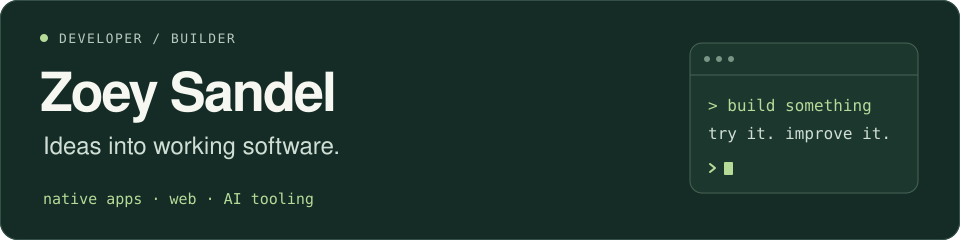

I like turning ideas into something you can actually use. That might be a native Mac app, a web prototype, or an integration that lets an AI agent do something useful.

### A few things I've built

| Project | What it does |
| :--- | :--- |
| [**Pomodoro Notch**](https://github.com/zoeysandel/pomodoro-notch) | A focus timer in your Mac's notch, controlled from chat or the native app. macOS proof of concept. Swift · SwiftUI · AppKit · Python · MCP |
| [**Career Signal Finder**](https://github.com/zoeysandel/career-signal-finder) | A prototype that turns a work story into a shortlist of public OpenAI roles, with evidence and source links. Independent project. React · Vite · Node.js · OpenAI API |
| [**9292 MCP**](https://github.com/zoeysandel/9292-nl-mcp) | Dutch public transport planning through a local, read-only MCP server. Unofficial integration. JavaScript · Node.js · MCP |
| [**Agent Skills**](https://github.com/zoeysandel/skills) | Reusable agent workflows for prompt writing and prototyping within a time and usage budget. Markdown · Python · Agent skills |

### My toolbox

- **Native apps:** Swift, SwiftUI, AppKit
- **Web:** JavaScript, React, Vite, Node.js
- **AI tooling:** Python, MCP, reusable agent skills

I enjoy the whole loop: figuring out the problem, building a small version, and learning from using it.
